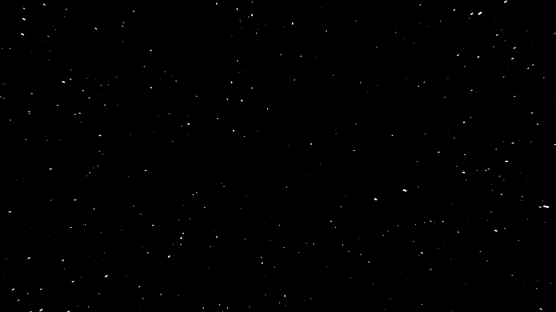

# Starfield

Classic Windows-style starfield screensaver. For **Mac**, **Windows** and plain **HTML**



**[▶ Try the HTML version in your browser](https://waschmittel.github.io/starfield/)**

Prebuilt screensavers are on the [Releases page](https://github.com/waschmittel/starfield/releases):
macOS, Windows Direct2D (Windows 10/11) and Windows GDI (**use this one on old Windows versions**).

## Version Comparison

All versions share the same algorithm and settings (speed, trail length, star density); they differ in platform and how they render.

| | [HTML](starfield.html) | [macOS](macos/README.md) | [Windows GDI](windows-gdi/README.md) | [Windows Direct2D](windows-direct2d/README.md) |
|---|---|---|---|---|
| Type | Web page (also [hosted](https://waschmittel.github.io/starfield/)) | `Starfield.saver` | `Starfield.scr` | `Starfield.scr` |
| Stack | HTML + JS canvas | Swift + Core Graphics | C + Win32 + GDI | C++ + Direct2D/D3D11 |
| Rendering | Canvas 2D, anti-aliased | Core Graphics, anti-aliased | CPU, not anti-aliased | GPU, anti-aliased |
| Look | Reference | Close port | Close port, slightly harsher | Close port, smooth |
| Refresh rate | Browser (`requestAnimationFrame`) | Per-screen `CADisplayLink` (macOS 14+), 60 Hz timer on 13 | `DwmFlush` (compositor rate) | Per-monitor vsync, one thread each |
| Changing visuals | Edit the HTML/JS | Edit Swift | Edit C | Edit C++ |
| Needs on target PC | A modern browser | Nothing | Nothing | Nothing |
| Minimum OS | Any with a modern browser | macOS 13 | Windows 7 | Windows 10 |
| Toolchain | None | Xcode Command Line Tools | MinGW-w64 (any OS) or MSVC | MinGW-w64 (any OS) or MSVC |

- **HTML**: try it instantly in a browser; not a real screensaver (fullscreen mode just keeps the screen awake).
  Controls: `F`/double-click fullscreen, `↑ ↓`/wheel speed, `← →` trail length, `+ −` star density, `Space` pause.
  On a phone or tablet, open the [hosted version](https://waschmittel.github.io/starfield/) and use *Add to Home Screen*: it installs as a fullscreen app that keeps the screen awake.
- **macOS**: the native screensaver for Macs.
- **Windows GDI**: the smallest, most compatible file (software-only, ~175 KB). **Use this one on old Windows versions.**
- **Windows Direct2D**: smooth, anti-aliased, GPU-driven rendering on Windows 10+ (~300 KB); best choice for
  high-resolution and high-refresh-rate monitors.

The two Windows versions share their settings (`HKCU\Software\Starfield`).

## Unsigned files (macOS and Windows)

The prebuilt screensavers are not signed with a paid Apple Developer ID or a Windows code-signing
certificate, so the operating systems warn about them. The build is open source and produced by
the [release workflow](.github/workflows/release.yml); you can also build it yourself.

### macOS

The saver is only ad-hoc signed and not notarized, so Gatekeeper blocks a downloaded copy
("Apple could not verify ... is free of malware").

1. Unzip and double-click `Starfield.saver`. If macOS refuses, open **System Settings > Privacy & Security**,
   scroll down and click **Open Anyway** next to the Starfield message, then confirm.
2. Or remove the download quarantine flag in Terminal before installing:
   ```bash
   xattr -dr com.apple.quarantine Starfield.saver
   ```
   (use the path where you put it, e.g. `~/Library/Screen Savers/Starfield.saver` if already installed).
3. Pick **Starfield** in **System Settings > Screen Saver**. If an older version is installed, run
   `killall legacyScreenSaver WallpaperAgent` so the new one is loaded.

### Windows

The `.scr` files are not code-signed, so SmartScreen may show **Windows protected your PC**, and the
downloaded file is marked as coming from the internet.

1. Right-click the `.scr` file > **Properties**, tick **Unblock** at the bottom of the General tab, **OK**.
2. Right-click the file > **Install**. If SmartScreen appears, click **More info > Run anyway**.
3. Browsers and antivirus tools may also flag an unsigned `.scr` as uncommon; you may have to choose
   **Keep** in the download list.

Alternatively, unblock it from PowerShell: `Unblock-File .\Starfield-windows-direct2d-*.scr`
